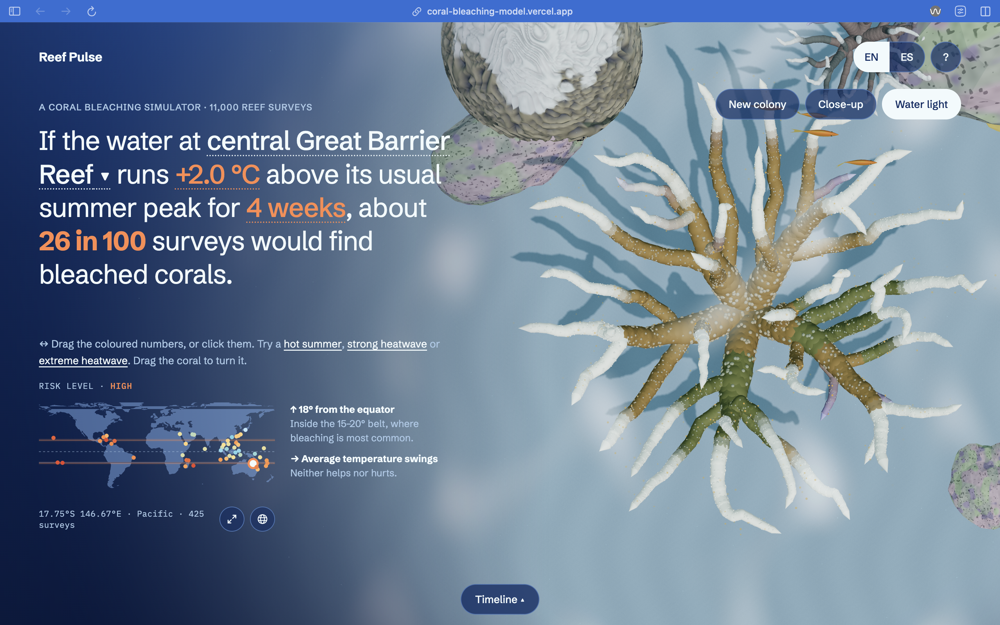

# Coral Bleaching Monitor

Coral bleaching is one of the most visible consequences of ocean warming — but the data behind it is rarely accessible to non-scientists. This project turns 40 years of global observations into an interactive web app where anyone can explore how rising temperatures affect coral reefs around the world.



---

## What it does

Select a reef on the Equal Earth world map, adjust environmental conditions with the sliders, and see the predicted bleaching outcome in real time — powered by a two-stage XGBoost model trained on 40 years of observations.

| Page | Description |
|------|-------------|
| Explore Reefs | Interactive world map + sliders to ask *what if* — what happens if the ocean warms by 2°C? If thermal stress doubles? |
| Data & Science | 40 years of bleaching trends, an interactive historical timeline, and how the prediction model works. |

---

## Stack

| Layer | Tech |
|-------|------|
| Frontend | React 18, D3-geo (Equal Earth projection), Recharts |
| Backend | Flask, Flask-CORS |
| ML | XGBoost, scikit-learn, SHAP, joblib |
| Data | pandas, numpy |

---

## Run locally

```bash
# Install root dependencies (only needed once)
npm install

# Start API + frontend together
npm run dev
```

- Flask API → `http://localhost:5001`
- React app → `http://localhost:3000`

The React app proxies all `/api/*` requests to Flask via the `proxy` field in `client/package.json`.

**Python dependencies** (also only once):

```bash
pip install -r requirements.txt
```

---

## Project structure

```
├── api/
│   ├── app.py               Flask REST API
│   └── requirements.txt     Python dependencies
│
├── client/
│   └── src/
│       ├── App.js
│       ├── index.css        Design tokens + global styles
│       └── reefpulse/       All frontend components
│
├── data/
│   └── coral_clean.csv      23,203 cleaned observations (1980–2020)
│
├── models/                  Serialized XGBoost pipelines + SHAP explainer
│
├── dev-notebooks/           Data cleaning, EDA, model training (01–04)
│
├── scripts/
│   └── build_app_data.py    Regenerates client data from models + raw surveys
│
└── package.json             Root dev script (concurrently)
```

---

## How the model works

**Data:** 23,203 coral bleaching observations across 5 ocean basins, sourced from the [Global Coral Reef Monitoring Network](https://www.kaggle.com/datasets/mehrdat/coral-reef-global-bleaching).

**Two-stage pipeline:**
1. **Classifier** — predicts whether bleaching occurs (yes/no)
2. **Regressor** — if yes, estimates severity (0–100%)

Nearly 40% of observations show 0% bleaching, so a single model would be biased toward predicting "not much." The two-stage approach avoids this.

**Strongest predictors:** Degree Heating Weeks (DHW) and sea surface temperature anomaly (SSTA) — consistent with decades of marine biology research.

Trained on pre-2016 data, evaluated on 2016–2020. SHAP values are computed at inference time to explain each individual prediction.

---

*Built to make climate science accessible — you don't need to be a marine biologist to understand what's happening to coral reefs.*
